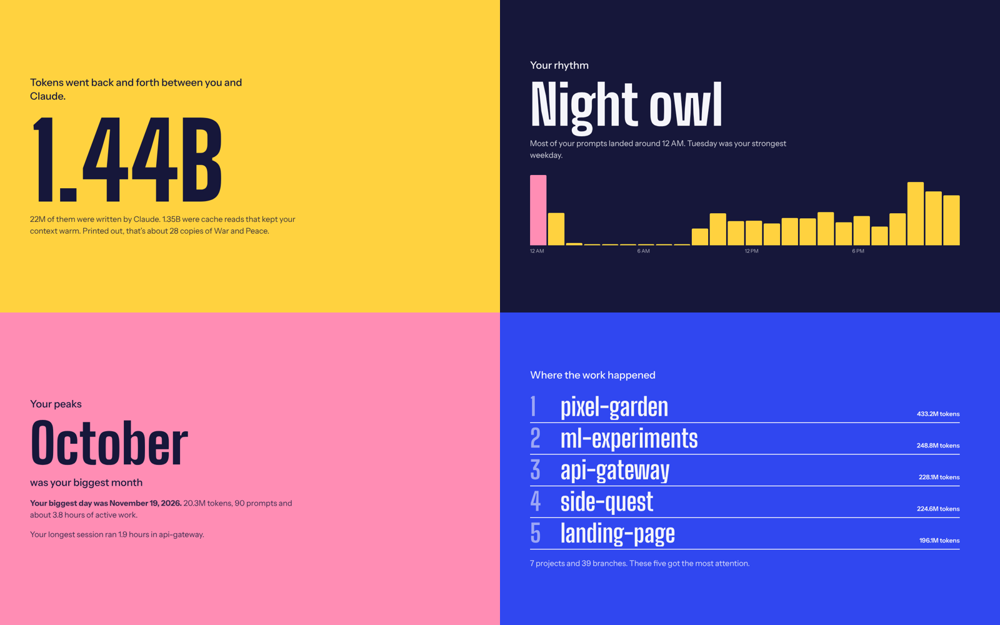
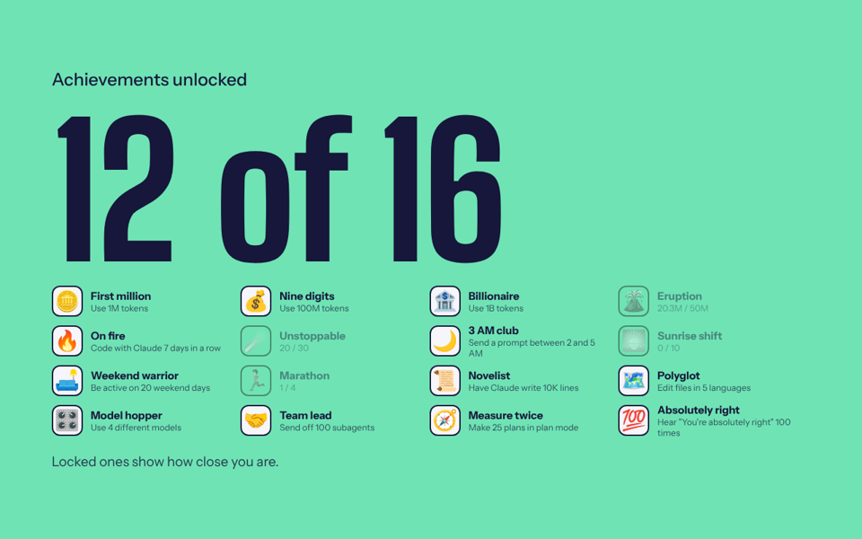
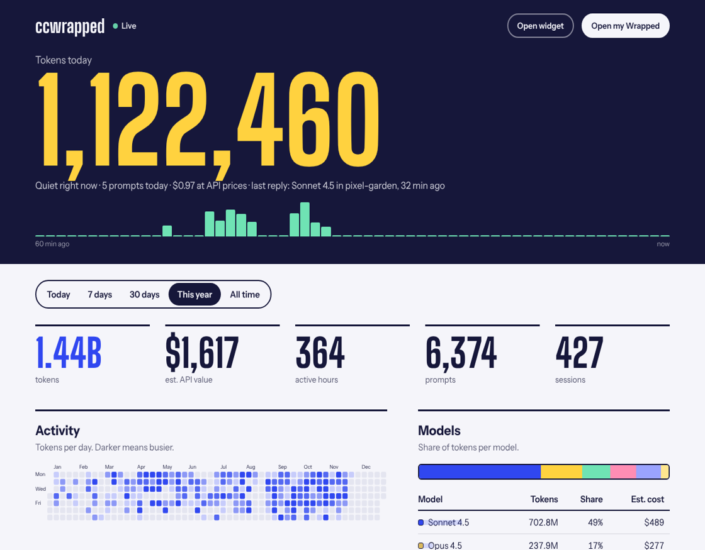
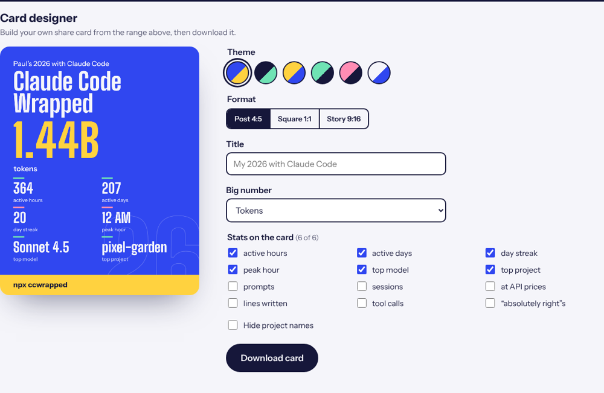
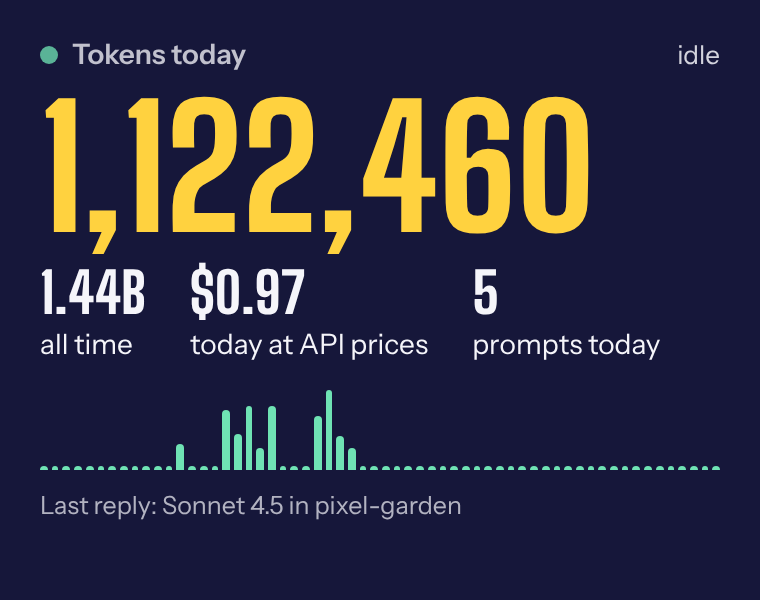
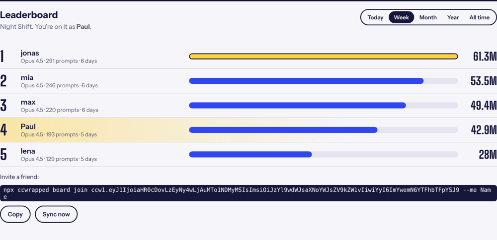
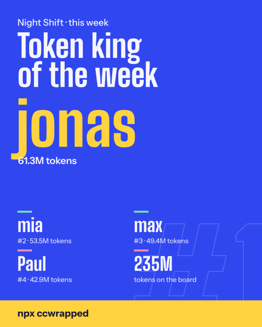

# ccyear: Claude Code Wrapped

**Your Claude Code usage, wrapped.** A year-in-review report, a live dashboard on localhost, a desktop token counter, a status line for Claude Code, achievements and a leaderboard to see which of your friends burns the most tokens. Everything is computed locally from the logs Claude Code already keeps on your machine.


```bash
npx @swulfen/ccyear           # your Wrapped report
npx @swulfen/ccyear serve     # live dashboard on http://localhost:4747
npx @swulfen/ccyear widget    # small live token counter window
```

Or install it as a Claude Code plugin and just ask Claude for your stats:

```
/plugin install ccyear --marketplace swulfen13/claude-wrapped
```



## Wrapped report

A story you scroll through, then the full breakdown.

- **Tokens:** total, how much Claude wrote, how much came from the cache
- **Time:** active hours, active days, longest streak, sessions, prompts
- **Rhythm:** peak hour and weekday. Are you a night owl or an early bird?
- **Peaks:** best month, best day, longest session
- **Models:** which models you used and how much of the work each one did
- **Projects:** top repos by tokens, sessions and prompts, plus how many branches you touched
- **Tools:** tool calls, favorite tool, lines written, files touched, plans and subagents. Also how often Claude said "You're absolutely right"
- **API value:** what it would have cost at API list prices
- **Activity calendar:** a GitHub-style heatmap, plus charts by month, weekday and hour
- **Coding style:** are you The Refactorer, The Researcher, The Commander, The Delegator, The Architect or The Explorer?
- **Achievements:** 16 to unlock, from *First million* and *3 AM club* to *Billionaire* and *Absolutely right*
- **Year over year:** how this year compares to the last one
- **Share card:** a PNG ready for X, LinkedIn or Instagram



## Live dashboard

`npx @swulfen/ccyear serve` starts a dashboard that updates every few seconds while you work. It only reads what was appended to your logs since the last update, so it stays fast even with years of history.



- A live counter of today's tokens, tokens per minute, and the last hour minute by minute
- Today, 7 days, 30 days, this year or all time
- Models, projects, tools and the activity calendar for the range you pick
- Your friends leaderboard
- A **card designer**: six themes, three formats (post 4:5, square, story 9:16), your own title, the big number of your choice and up to six stats. Download it as a PNG.



The dashboard only listens on `127.0.0.1`, so nobody else on your network can open it.

## Status line for Claude Code

Show today's tokens, cost and burn rate right in Claude Code's status bar:

```
Opus 4.5 │ my-app │ 🔥 12.4M today │ $8.20 │ ~84K/min │ 41% of $20
```

```bash
npm i -g @swulfen/ccyear
ccyear statusline --install
```

This adds a `statusLine` entry to `~/.claude/settings.json` and keeps everything else. If you already have a status line, it asks you to pass `--force` and saves a backup first. It's instant while `ccyear serve` is running and reads only today's logs otherwise.

## Daily budget

```bash
ccyear budget --usd 20       # or --tokens 50M, or --off
```

The dashboard, the widget and the status line turn yellow at 80% and red once you go over. Handy if you pay per token through the API.

## Desktop widget

`npx @swulfen/ccyear widget` opens a small window with today's tokens counting up live, your all-time total, today's API value and a one-hour sparkline. It uses the app mode of Chrome or Edge, so there's no browser UI around it. Without either, it opens in a normal tab.

<p></p>

You can also point any desktop widget tool that shows web pages at `http://localhost:4747/widget`.

## Friends leaderboard



Leaderboards run on **your own free Supabase project**, so you and your friends own the data. Nobody else hosts anything.

Only daily totals are uploaded: tokens, output tokens, prompts, estimated cost and tokens per model. **Never prompts, code, file names or project names.**

### Set it up with Claude (easiest)

With the plugin installed, ask Claude Code:

> Set up a ccyear leaderboard for me and my friends

The `leaderboard-setup` skill connects to Supabase through the [Supabase MCP server](https://supabase.com/docs/guides/getting-started/mcp), applies the schema to the project you choose, creates the board and gives you the invite to send around. It asks before it creates or changes anything.

### Set it up by hand

1. Create a project on [supabase.com](https://supabase.com). The free tier is enough.
2. Open **SQL Editor**, paste [`supabase/schema.sql`](supabase/schema.sql) and run it.
3. Copy the project URL and the publishable key from **Project Settings → API keys**.
4. Create your board:

   ```bash
   npx @swulfen/ccyear board create --name "Night Shift" --me Paul \
     --url https://xyz.supabase.co --key sb_publishable_...
   ```

5. Send the invite it prints to your friends. They run:

   ```bash
   npx @swulfen/ccyear board join ccw1.... --me Lena
   ```

Your totals sync every 10 minutes while `serve` is running. You can also run `npx @swulfen/ccyear sync` yourself or from a scheduled job.

```bash
npx @swulfen/ccyear leaderboard --period week   # today, week, month, year, all
npx @swulfen/ccyear leaderboard --by days       # tokens, days, prompts, output
npx @swulfen/ccyear board invite                # print the invite again
npx @swulfen/ccyear board leave                 # leave and delete your data on that board
```

In the dashboard you can rank by **tokens, active days or prompts**, so the friend with the most consistent week can win too. **Make winner card** turns the current ranking into a "Token king of the week" card to post in your group chat.

<p></p>

**How it stays safe:** the tables have row level security turned on and no policies, so the public key can't read or write them. Everything goes through a few database functions. Joining needs the invite code, and writing your stats needs a secret that only your machine knows. The database only stores a hash of it.

## CSV export

For invoices, client reports or your own spreadsheets:

```bash
npx @swulfen/ccyear export --by project         # also: day, model, session
npx @swulfen/ccyear export --by day --period month
```

Each row has sessions, prompts, active hours, all four token types, estimated cost and first and last activity. The dashboard has the same export for whatever range you're looking at.

## Badge for your GitHub profile

```bash
npx @swulfen/ccyear badge                       # --metric tokens, hours, streak, cost, achievements, style
```

It saves an SVG and prints the Markdown line to paste into your profile README.

## All options

| Command / option | What it does |
| --- | --- |
| `--year <yyyy>` | Year to wrap. Default: the current year |
| `--all` | Use all of your history |
| `--name <name>` | Put your name on the report |
| `--lang <en\|de>` | Report language. Default: English |
| `--anonymize` | Replace project names with `project-1`, `project-2`, … |
| `--out <file>` | Where to save the report |
| `--json` | Print stats as JSON |
| `--dir <path>` | Read logs from an extra folder |
| `--demo` | Use generated sample data instead of your logs |
| `--no-open` | Don't open the browser |
| `serve --port <n>` | Dashboard port. Default: 4747 |

Requires Node.js 18 or newer. There are no dependencies.

## Privacy

ccyear reads the session logs in `~/.claude/projects` (also `~/.config/claude/projects` and `$CLAUDE_CONFIG_DIR`). The report, the dashboard and the widget never send your data anywhere. Their only network requests load two Google Fonts, and they fall back to system fonts when you're offline. The only data that ever leaves your computer is the daily totals described above, and only after you join a leaderboard.

## How the numbers are calculated

- **Tokens** are input + output + cache write + cache read. Streamed chunks of the same message are counted once.
- **Active time** adds up gaps of 10 minutes or less between consecutive events, so idle time doesn't count.
- **Prompts** are messages you typed. Tool results and slash-command scaffolding don't count.
- **API value** uses public per-model list prices, with cache writes at 1.25× and cache reads at 0.1× the input price. New models fall back to their family's price, so treat it as a ballpark.
- **Languages** come from the file extensions of files Claude edited or wrote.

## Development

```bash
npm test                                    # unit tests
npm i --no-save @electric-sql/pglite        # optional: also test the SQL and the full leaderboard flow
npm test
node bin/claude-wrapped.js serve --demo     # dashboard with sample data
node test/fake-supabase.js                  # local stand-in for Supabase on :54321
```

Ideas and pull requests are welcome.

---

Not affiliated with or endorsed by Anthropic. "Claude" is a trademark of Anthropic.
