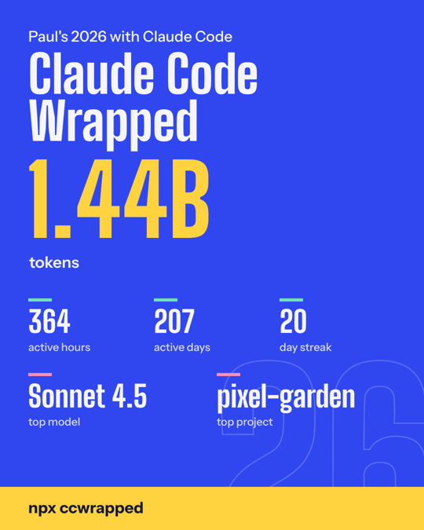

# Claude Code Wrapped

**Your year with Claude Code, wrapped.** Tokens, models, projects, active hours, your best month and day, and a card you can share. Everything is computed locally from the logs Claude Code already keeps on your machine.

```bash
npx ccwrapped
```


## What you get

A story-style report that opens in your browser, followed by a full breakdown:

- **Tokens.** Total, how much Claude wrote and how much came from the cache.
- **Time.** Active hours, active days, your longest streak, sessions and prompts.
- **Rhythm.** Your peak hour and weekday, and whether you're a night owl or an early bird.
- **Peaks.** Best month, best day, longest session.
- **Models.** Which models you used and how much of your work each one did.
- **Projects.** Your top repos by tokens, sessions and prompts, plus how many branches you touched.
- **Tools.** Tool calls, favorite tool, lines written, files touched, plan-mode plans, subagents. Also how often Claude said "You're absolutely right".
- **API value.** What your usage would have cost at API list prices. This is an estimate, and subscription users don't pay it.
- **Activity calendar.** A GitHub-style heatmap of your year, plus charts by month, weekday and hour.
- **Share card.** A 1080×1350 PNG, ready for X, LinkedIn or Instagram.

<p align="center"></p>

## Usage

```bash
npx ccwrapped                 # this year
npx ccwrapped --year 2025     # a specific year
npx ccwrapped --all           # your whole history
npx ccwrapped --name Paul     # "Paul's 2026 with Claude Code"
npx ccwrapped --lang de       # German report (auto-detected from your system)
npx ccwrapped --anonymize     # hide project names before you share
npx ccwrapped --demo          # try it with generated sample data
npx ccwrapped --json          # raw numbers for your own scripts
```

| Option | What it does |
| --- | --- |
| `--year <yyyy>` | Year to wrap. Default: the current year |
| `--all` | Use all of your history |
| `--name <name>` | Put your name on the report |
| `--lang <en\|de>` | Report language |
| `--anonymize` | Replace project names with `project-1`, `project-2`, … |
| `--out <file>` | Where to save the HTML file |
| `--dir <path>` | Read logs from an extra folder |
| `--json` | Print stats as JSON instead of writing HTML |
| `--demo` | Use sample data instead of your logs |
| `--no-open` | Don't open the browser |

Requires Node.js 18 or newer. There are no dependencies.

### Running from source

```bash
git clone https://github.com/swulfen13/Claude-Wrapped.git
cd Claude-Wrapped
node bin/claude-wrapped.js
```

## Privacy

Claude Wrapped reads the session logs in `~/.claude/projects` (and `~/.config/claude/projects` or `$CLAUDE_CONFIG_DIR` if you use those). It never sends anything anywhere. The report is one HTML file on your disk. Its only network requests are for two Google Fonts, and it falls back to system fonts when you're offline.

The share card contains only the numbers you see on it. Use `--anonymize` if your project names are private.

## How the numbers are calculated

- **Tokens** are input + output + cache write + cache read tokens. Streamed chunks of the same message are counted once.
- **Active time** adds up the gaps between consecutive events that are 10 minutes or shorter, so idle time and lunch breaks don't count.
- **Prompts** are messages you typed. Tool results and slash-command scaffolding aren't counted.
- **API value** uses the public per-model list prices. Cache writes cost 1.25× input and cache reads 0.1× input. New models fall back to their family's price, so treat this number as a ballpark.
- **Languages** come from the file extensions of files Claude edited or wrote.

## Contributing

Ideas and pull requests are welcome, especially new stats, new languages for the report, and support for other tools.

```bash
npm test
npm run demo
```

---

Not affiliated with or endorsed by Anthropic. "Claude" is a trademark of Anthropic.
